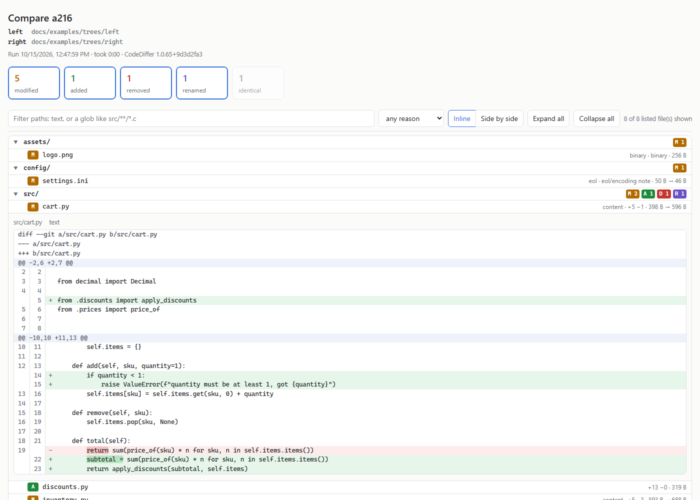
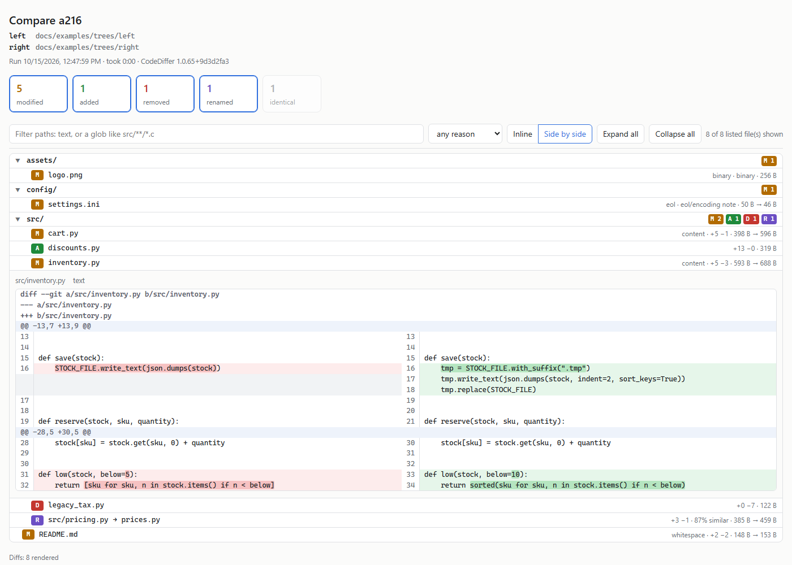
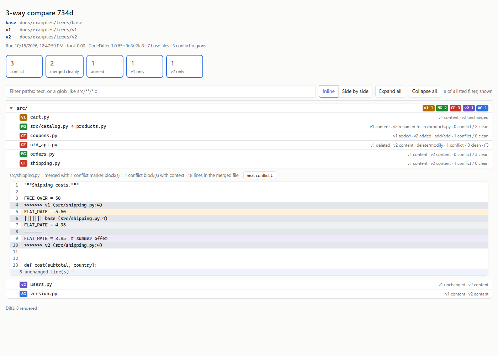
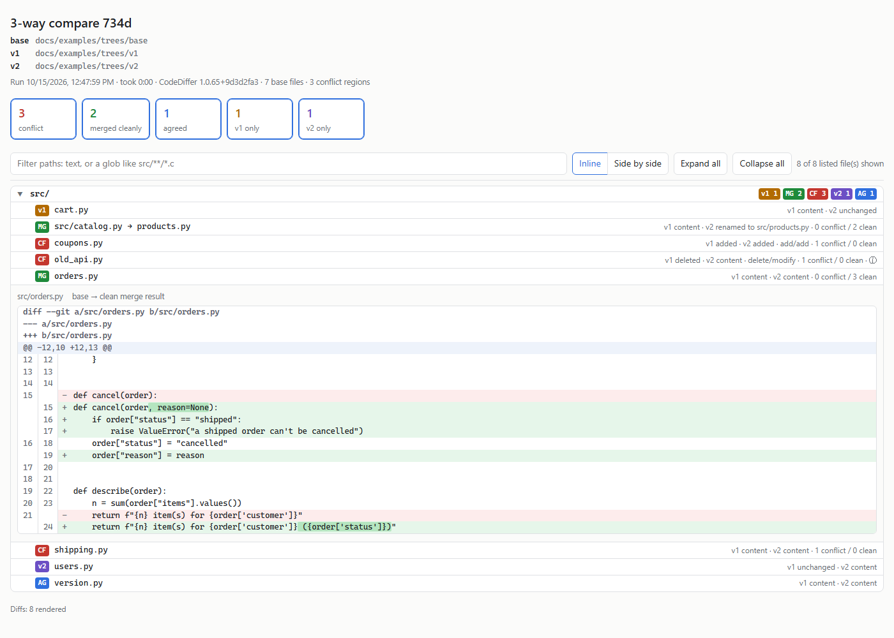

# CodeDiffer 🔀

**A 2-/3-/n-way diff tool for VERY large trees — ~100 GB, individual files over 1 GB, local or over a
network share — built agent-first so an AI coding agent can diff two trees, see what changed, and port a
change from one to another without being crushed by the scale or drowned in output.**

> ⚠️ **WIP — not yet real-world tested.** The design is locked ([`DESIGN.txt`](DESIGN.txt)) and the
> ground-truth contract with [CodeSpawner](https://github.com/RelentlessOldMan/CodeSpawner) is frozen
> ([`docs/diff-delta-contract.md`](docs/diff-delta-contract.md)). Validated at full scale on CodeSpawner's
> synthetic `death` corpus over SMB (68,661 files, ~90 GB; the 3-way merge reproduces its conflict oracle
> exactly), but **not yet on a genuine production tree.**

Classic diff tools (`diff -r`, `git diff --no-index`, WinMerge/Meld/Beyond Compare) are built for
human-scale trees and for humans or shell pipelines. Point one at a dozens-of-GB firmware tree with 1 GB
machine-generated register headers over SMB and it falls over or floods you. An agent diffing such a tree
has a second failure mode: a monolithic result blows its whole context window. CodeDiffer is built for
exactly this case.

## The idea

- **The output is a session, not a document.** A compare writes an on-disk result store (outside the
  compared trees); the agent pages bounded queries against it and a self-contained HTML report lazily
  loads from it. Nothing materializes the full diff up front.
- **A cost-ordered funnel:** walk + stat → hash (cached) → reason → hunks, where only the last tier is
  lazy and per-file. A full 90 GB compare costs the agent ~a few hundred tokens plus the files it opens.
- **Giant files diffed at the block level, never whole** — streamed once into content-defined chunks
  (16–256 KB, SHA-256 each), matched, and reported as a bounded list of changed byte ranges.
- **Honest at scale** — every cap/sample disclosed; every `modified` carries a reason
  (`content\|eol\|whitespace\|encoding\|binary\|metadata`); never "modified" with an empty diff.
- **Change porting is first-class** — diff A→B, dry-run onto C with per-hunk `applied\|fuzzy\|conflict`;
  3-way merge under diff3 conflict semantics.

Full output model: [`docs/OUTPUT.md`](docs/OUTPUT.md).

## Family

CodeDiffer is one of a family of local, large-repo tools (shared author, stack, and patterns):

- **CodeCompass** — fast local code search / nav over huge repos. CodeDiffer borrows its memory-mapped /
  streaming / SMB-aware / block-sidecar patterns, and (v2) its symbol index for structural-diff
  blast-radius. CodeDiffer has **no dependency** on it; a fresh index is an optional warm hash source.
- **CodeCarver** — reachability slicing: carve a huge repo to the minimal buildable slice.
- **CodeSpawner** — deterministic synthetic corpus generator + ground-truth manifest. CodeDiffer's
  correctness oracle: its bulk `mutate` regenerates the same ~100 GB corpus with a dialable set of
  changes and emits a delta manifest CodeDiffer asserts against.

## Use it

Two exes over one engine, shipped as a Claude Code (and Codex) plugin, the CodeCompass model. The
[Releases](https://github.com/RelentlessOldMan/CodeDiffer/releases) page has it as a self-contained
Windows x64 zip, `codediffer-plugin-<version>-win-x64.zip` (no .NET needed; `INSTALL.txt` inside). Unzip it
somewhere stable (the unzipped folder IS the plugin), then in Claude Code:

```
/plugin marketplace add "C:\path\to\codediffer-plugin-<version>-win-x64"
/plugin install codediffer@codediffer
```

(or `claude --plugin-dir "<folder>"` for one session; Codex: `./install-codediffer.ps1 -TargetHost Codex`).
From source: `./build-plugin.ps1` builds `plugin\bin`, then point at `<repo>\plugin` the same way;
`./make-release.ps1` builds the zip. [`plugin/README.md`](plugin/README.md) has the details.

- **`CodeDiffer.Cli.exe`** — `compare <left> <right>` (status + reason per file; `--patch` for a
  `git apply`-able patch), `compare3 <base> <v1> <v2>` (3-way: v1 only · v2 only · agreed · merged ·
  conflict; `--merge-out DIR` writes the merge as an overlay on v1), `apply-overlay <dir> <target> [--write]`
  (apply that overlay), `apply <left> <right> <target> [--write]` (port a change set onto a third tree), `diff <a> <b>`,
  `blockdiff`, `verify`, `report <id>` (HTML report of a saved compare; or `--html` on `compare`/`compare3`),
  `results` (saved compares; `--prune` deletes all but the newest N, a dry run unless `--yes`). `help` lists the flags.
- **`CodeDiffer.Mcp.exe`** — the stdio MCP server for agents, registered by the plugin. Tools: `start_compare` / `start_compare3`
  (background, return an id), `get_summary` (constant size; while running: progress, time left and the
  differences found so far, which `list_files` / `get_file_diff` can already open), `list_files` (paged/filtered), `get_file_diff`
  (one file, capped — a 2-way patch, or a 3-way merge with diff3 conflict markers; the overflow goes to a
  file), `get_stats`, `export_changeset` (whole patch to a file), `apply_changeset` (port the changes onto a
  third tree by 3-way merge; dry run unless `write=true`), `write_report` (the HTML report, for a human), `write_merge` (a compare3's merge as an overlay on v1:
  the changed files, text conflicts with diff3 markers, a deletes list; CLI `compare3 --merge-out DIR`),
  `list_compares` (saved compares; any id reopens without re-comparing), `get_run_telemetry` (how recent
  compares ran, numbers only: how each ended, memory, time per phase, network vs work), `cancel_compare` (stop a running
  compare; the hashes it read are kept, so starting it again only reads the rest; Ctrl+C in the CLI).

Every finished compare is saved to a fresh `yyyyMMdd-HHmmss-<id>` directory under
`%LOCALAPPDATA%\CodeDiffer\results` (override `CODEDIFFER_RESULTS_DIR`; never inside a compared tree): the
verdicts as JSON lines, plus whatever is derived later (capped patches, apply reports, `report\index.html`).
The HTML report is a small static page that opens straight from disk: a folder tree with status/reason/path
filters, identical files hidden, and each file's diff (inline or side by side, intra-line marks; 3-way merges
with colored conflict sections) loaded only when expanded.

### What the report looks like

Live examples (open in the browser, click any file): a
[2-way compare](https://relentlessoldman.github.io/CodeDiffer/examples/compare/) and a
[3-way compare](https://relentlessoldman.github.io/CodeDiffer/examples/compare3/), of a small made-up project
with one file for each kind of change.

| 2-way, inline | 2-way, side by side |
|---|---|
|  |  |
| **3-way, a conflict with diff3 markers** | **3-way, a clean merge (base → merged)** |
|  |  |

[`docs/examples/make-examples.ps1`](docs/examples/make-examples.ps1) regenerates all of it from this checkout
(or from trees of your own: `-Left/-Right`, `-Base/-V1/-V2`), with nothing of the machine left in it.

## Build & test

```powershell
dotnet build CodeDiffer.slnx -c Release
dotnet test  CodeDiffer.slnx -c Release
```

Libraries target **net8.0** (fleet floor); the CLI, the MCP server and the tests (which cover all three)
target **net10.0** (requires the .NET 10 SDK to build). See [`DESIGN.txt`](DESIGN.txt) for architecture and the regression suite seeded from a
prototype-diff-tool review.

## Contributing

This is a personal tool, published as-is — **issues and pull requests aren't accepted** (PRs auto-close).
Fork it and make it your own. 🔀

## License

MIT — see [LICENSE](LICENSE). © 2026 RelentlessOldMan.
